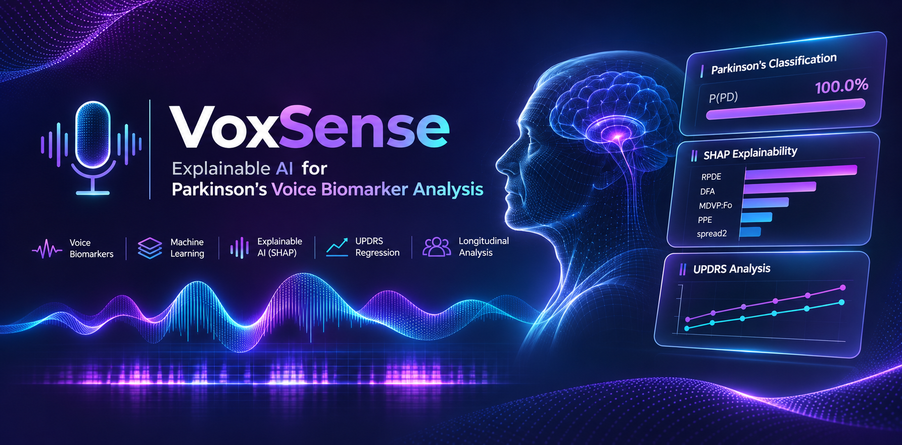
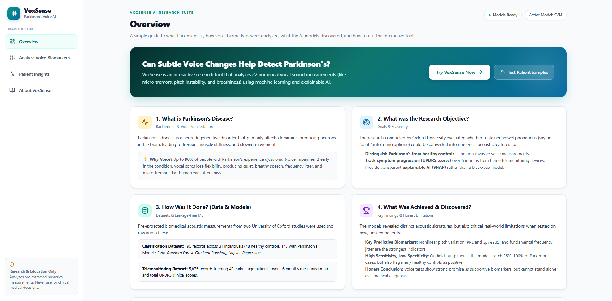
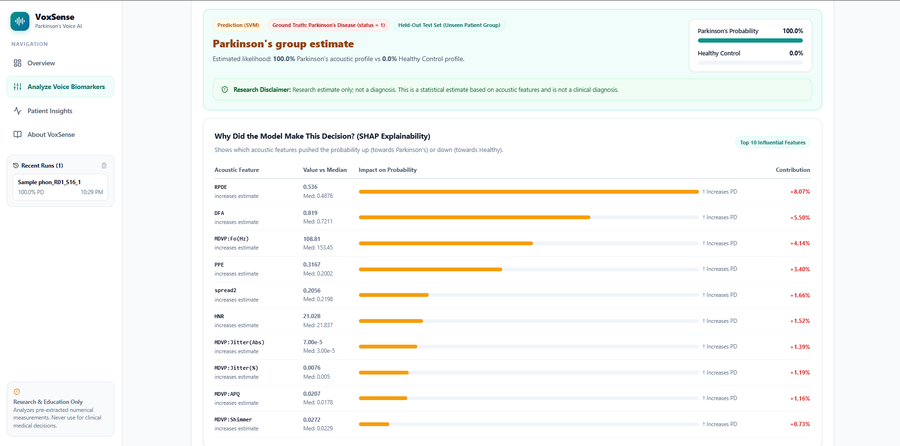
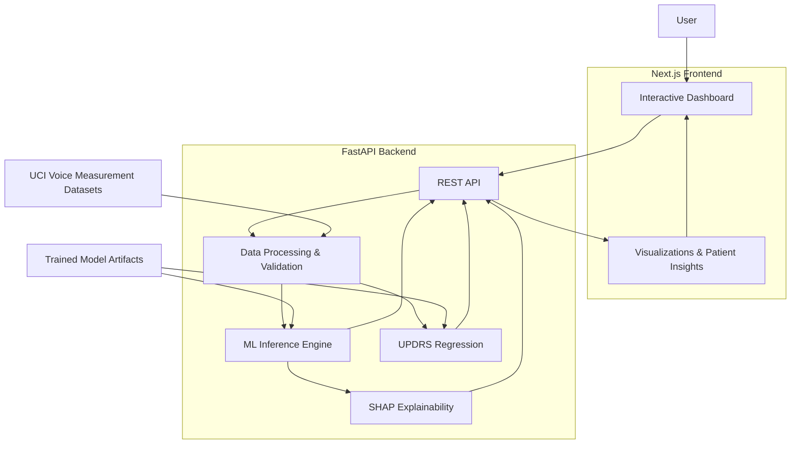

<p align="center">
  
</p>

<p align="center">
  <a href="https://voxsense-ruby.vercel.app/">
    
  </a>
  <a href="https://github.com/RagulRishwanth/VoxSense">
    
  </a>
</p>

<p align="center">
  
  
  
  
  
  
</p>

---

> **Research & Educational Application**
>
> VoxSense analyzes pre-extracted numerical acoustic measurements. It does not process raw audio recordings, perform speech recognition, or provide clinical diagnoses. Predictions are statistical estimates and must not be used for medical decisions.

---

## 📌 Overview

**Can subtle changes in voice reveal patterns associated with Parkinson's disease?**

VoxSense is an interactive machine learning research platform designed to explore this question through biomedical acoustic measurements and explainable AI.

Parkinson's disease can affect speech production, resulting in changes in vocal frequency, amplitude, pitch stability, and other acoustic characteristics.

VoxSense brings together two publicly available biomedical voice datasets to explore different machine learning tasks:

- **Classification:** Investigating whether extracted acoustic measurements can distinguish Parkinson's disease samples from healthy control samples.
- **Severity Regression:** Exploring the relationship between vocal acoustic measurements and Motor UPDRS and Total UPDRS scores.
- **Longitudinal Analysis:** Visualizing repeated patient measurements and symptom-score trends over time.
- **Explainable AI:** Understanding the acoustic features influencing individual predictions and overall model behavior.

The application combines these capabilities in an interactive web interface, allowing users to explore acoustic biomarkers, generate predictions, examine SHAP explanations, and investigate patient-level longitudinal measurements.

### Application Preview

<p align="center">
  
</p>

<p align="center">
  <em>VoxSense — Research overview, datasets, methodology, and findings.</em>
</p>

## ✨ Key Features

### 1. Interactive Parkinson's Classification

Explore classification models using numerical acoustic feature profiles.

- Manual entry of 22 acoustic measurements.
- Healthy and Parkinson's median feature profiles.
- Sample patient analysis.
- CSV-based batch predictions.
- Classification probability estimates.
- Model prediction visualization.

### 2. Explainable AI — SHAP

VoxSense integrates SHAP (SHapley Additive exPlanations) to make model predictions more transparent.

- Individual prediction explanations.
- Global feature importance.
- SHAP summary visualizations.
- Positive and negative feature contributions.
- Acoustic feature contribution rankings.
- Interpretable insights into model behavior.

<p align="center">
  
</p>

<p align="center">
  <em>Individual acoustic biomarker contributions using SHAP explainability.</em>
</p>

### 3. UPDRS Severity Analysis

Separate regression workflows explore two clinical severity measures:

- Motor UPDRS prediction.
- Total UPDRS prediction.
- Regression model comparison.
- MAE, RMSE, and R² evaluation.
- Feature-based regression analysis.

### 4. Longitudinal Patient Insights

Explore repeated measurements across participants in the telemonitoring dataset.

- Individual participant profiles.
- Motor UPDRS trends over time.
- Total UPDRS trends over time.
- Acoustic biomarker trajectories.
- Patient-level comparisons.
- Descriptive symptom progression visualizations.

These visualizations describe recorded measurements; they do not constitute validated future disease-progression forecasts.

### 5. Model Laboratory

A dedicated environment for exploring model evaluation and performance.

- Classification model comparison.
- Confusion matrices.
- ROC curves.
- Precision-recall analysis.
- Regression performance metrics.
- Feature importance visualizations.

### 6. Data Explorer

Explore the underlying datasets and their characteristics.

- Dataset previews.
- Feature descriptions.
- Missing-value analysis.
- Data quality summaries.
- Feature distributions.
- Statistical insights.

---

## 📊 Datasets

VoxSense uses two publicly available biomedical voice measurement datasets from the UCI Machine Learning Repository.

### Dataset 1: Parkinson's Disease Classification

**Source:** [UCI Machine Learning Repository — Parkinsons](https://archive.ics.uci.edu/dataset/174/parkinsons)

| Characteristic | Details |
|---|---|
| Original dataset instances | 197 |
| Actual CSV recordings | 195 |
| Acoustic features | 22 |
| Healthy controls | 48 |
| Parkinson's samples | 147 |
| Original participants | 31 |
| Target variable | `status` |

The classification dataset contains biomedical voice measurements collected from healthy individuals and individuals with Parkinson's disease.

The target variable represents:

- `0` — Healthy control
- `1` — Parkinson's disease group

The acoustic measurements include:

- MDVP:Fo
- MDVP:Fhi
- MDVP:Flo
- Jitter measurements
- Shimmer measurements
- NHR
- HNR
- RPDE
- DFA
- Spread1
- Spread2
- PPE

The dataset contains repeated recordings from participants. Recording-name prefixes are used to create recording-group-aware data splits.

The original `name` identifier is excluded from model predictors.

**Dataset documentation note:** The UCI repository describes 197 instances, while the supplied CSV contains 195 recording rows and an additional recording identifier column. This difference is retained for transparency.

### Dataset 2: Parkinson's Telemonitoring

**Source:** [UCI Machine Learning Repository — Parkinsons Telemonitoring](https://archive.ics.uci.edu/dataset/189/parkinsons+telemonitoring)

| Characteristic | Details |
|---|---|
| Records | 5,875 |
| Participants | 42 |
| Acoustic features | 16 |
| Original columns | 22 |
| Target variables | `motor_UPDRS`, `total_UPDRS` |
| Measurements per participant | 101–168 |

This dataset contains repeated voice measurements from 42 individuals with early-stage Parkinson's disease, collected during a six-month telemonitoring study.

It is used for:

- Motor UPDRS regression.
- Total UPDRS regression.
- Patient-level longitudinal exploration.
- Descriptive symptom trend analysis.

The dataset does not contain healthy control participants and is therefore not used for disease classification.

### Dataset Files

Download both datasets from their respective UCI sources.

Place the original files inside:

```text
data/
└── raw/
    ├── parkinsons.data
    ├── parkinsons.names
    ├── parkinsons_updrs.data
    └── parkinsons_updrs.names
```

The original datasets are intentionally excluded from Git. Users must obtain them from their respective sources.

---

## 🧠 Machine Learning Methodology

VoxSense implements two distinct machine learning workflows: binary classification and severity regression.

### 1. Classification Pipeline

The classification pipeline uses the Parkinson's Disease Classification dataset.

**Models compared:**

- Logistic Regression
- Support Vector Machine (SVM)
- Random Forest
- Gradient Boosting
- XGBoost (optional)

**Evaluation metrics:**

| Metric | Purpose |
|---|---|
| Accuracy | Overall classification correctness |
| Precision | Reliability of positive predictions |
| Recall | Ability to identify positive samples |
| F1-score | Balance between precision and recall |
| ROC-AUC | Discriminative ability across thresholds |
| Confusion Matrix | Classification error analysis |

**Leakage-aware evaluation**

The classification pipeline uses recording-group-aware splitting and grouped cross-validation.

This helps prevent recordings associated with the same participant from appearing in both training and testing partitions.

Model selection uses grouped cross-validation balanced accuracy, with ROC-AUC as a tie-breaker.

### 2. Severity Regression

The regression pipeline uses the Parkinson's Telemonitoring dataset.

Two independent targets are evaluated:

- `motor_UPDRS`
- `total_UPDRS`

The 16 acoustic measurements are used as predictors.

Patient identifiers, time, demographic attributes, and target variables are excluded from predictors.

**Evaluation metrics:**

- Mean Absolute Error (MAE)
- Root Mean Squared Error (RMSE)
- R² Score

A patient-disjoint holdout is used to evaluate generalization to previously unseen participants.

### 3. Preprocessing and Leakage Prevention

The implementation includes:

- Missing-value detection and median imputation.
- IQR-based outlier investigation.
- Feature scaling within training pipelines.
- Categorical and numerical preprocessing where applicable.
- Group-aware data splitting.
- Cross-validation and hyperparameter tuning.
- Fixed random seeds for reproducibility.

Preprocessing transformations are fitted only on training data. Raw datasets remain unchanged.

Class balancing is restricted to applicable training fits.

---

## 🔍 Explainable AI

A key component of VoxSense is the integration of SHAP (SHapley Additive exPlanations).

Rather than presenting predictions as unexplained outputs, the application provides feature-level insights into model behavior.

| Explainability Component | Purpose |
|---|---|
| Global Feature Importance | Identifies features influential across predictions |
| SHAP Summary Plot | Shows the distribution of feature contributions |
| Individual Explanations | Explains a particular prediction |
| Feature Contribution Ranking | Highlights influential measurements |
| Prediction Interpretation | Communicates model behavior in understandable language |

Acoustic measurements such as PPE, spread1, RPDE, DFA, and jitter-related features can be explored through the model's feature attribution outputs.

SHAP contributions represent associations learned by the model. They should not be interpreted as evidence of clinical causation.

---

## 🏗️ System Architecture

VoxSense follows a frontend-backend architecture.

The backend handles data processing, model inference, explainability, and API operations, while the frontend provides the interactive research experience.

### Architecture Diagram



### Technology Stack

| Component | Technologies |
|---|---|
| Frontend | Next.js, React, TypeScript |
| Styling | Tailwind CSS |
| Backend | Python, FastAPI |
| Data Processing | Pandas, NumPy |
| Machine Learning | Scikit-learn, XGBoost (optional) |
| Explainable AI | SHAP |
| Visualization | Recharts, Matplotlib, Plotly |
| Validation | Pydantic |
| Testing | Pytest |

---

## 🚀 Getting Started

### Prerequisites

- Python 3.11 (recommended)
- Node.js 20 or newer
- npm
- Git

### 1. Clone the Repository

```bash
git clone https://github.com/RagulRishwanth/VoxSense.git

cd VoxSense
```

### 2. Add the Datasets

Download both datasets from the UCI Machine Learning Repository.

Place the four original dataset files inside:

```text
data/raw/
```

### 3. Set Up the Backend

**Windows PowerShell:**

```powershell
cd backend

python -m venv .venv

.venv\Scripts\Activate.ps1

pip install -r requirements.txt
```

**macOS/Linux:**

```bash
cd backend

python3 -m venv .venv

source .venv/bin/activate

pip install -r requirements.txt
```

### 4. Train the Models

Run the training pipeline from the `backend/` directory:

```bash
python -m app.services.training
```

Trained model artifacts and measured evaluation results are written to:

```text
backend/artifacts/
```

The artifacts are excluded from Git and can be reproduced using the training pipeline.

### 5. Start the Backend

From the `backend/` directory:

```bash
python -m uvicorn app.main:app --reload
```

Backend:

```text
http://localhost:8000
```

Interactive API documentation:

```text
http://localhost:8000/docs
```

### 6. Start the Frontend

Open a second terminal:

```bash
cd frontend

npm install
```

Configure the backend API URL.

**Windows PowerShell:**

```powershell
$env:NEXT_PUBLIC_API_URL="http://localhost:8000/api"

npm run dev
```

**macOS/Linux:**

```bash
export NEXT_PUBLIC_API_URL="http://localhost:8000/api"

npm run dev
```

Open the application:

[http://localhost:3000](http://localhost:3000)

---

## 🔌 API Reference

The FastAPI backend exposes the following endpoints.

| Method | Endpoint | Description |
|---|---|---|
| GET | `/api/health` | Backend health check |
| GET | `/api/overview` | Dataset overview |
| GET | `/api/datasets` | Dataset information |
| GET | `/api/features/schema` | Model feature schema |
| GET | `/api/samples` | Sample records |
| GET | `/api/models/metrics` | Model evaluation metrics |
| GET | `/api/models/importance` | Global feature importance |
| GET | `/api/models/shap-summary` | SHAP summary |
| GET | `/api/records/classification` | Classification records |
| GET | `/api/records/severity` | Severity records |
| GET | `/api/progression/{patient_id}` | Patient progression data |
| GET | `/api/progression-summary` | Longitudinal summary |
| POST | `/api/predict/classification` | Parkinson's classification |
| POST | `/api/predict/severity` | UPDRS severity prediction |
| POST | `/api/explain` | Individual prediction explanation |
| POST | `/api/predict/batch` | Batch CSV classification |

Prediction endpoints require the exact feature names expected by the corresponding model.

Batch classification accepts CSV text or structured rows and returns validated predictions.

---

## ✅ Testing and Verification

The project has been tested locally.

| Verification | Result |
|---|---|
| Backend unit tests | 11 passed |
| Next.js production build | Passed |
| Grouped model training pipeline | Executed successfully |
| Model artifacts | Generated locally |
| SHAP individual explanations | Returned real values |
| SHAP global importance | Returned real values |
| SHAP summary endpoint | Returned PNG |
| Data exploration | Generated profiles and distribution plots |

The Windows environment initially encountered an invalid native SWC module and successfully fell back to the WASM compiler during the Next.js production build.

Detailed evaluation findings are documented in:

```text
reports/MODEL_EVALUATION.md
```

### Model Evaluation Transparency

The measured holdout results include poor classification specificity and negative R² values for severity regression.

These limitations are documented rather than concealed.

All metrics are generated from actual model evaluation. No performance results are fabricated.

---

## ⚠️ Limitations and Responsible Use

VoxSense is a research and educational application. It is not a clinically validated diagnostic tool.

Important limitations include:

1. The classification dataset is small and imbalanced.
2. The longitudinal dataset contains only 42 participants.
3. The longitudinal cohort consists of individuals with early-stage Parkinson's disease.
4. The supplied datasets contain extracted acoustic measurements, not original audio recordings.
5. There is no independent external validation cohort.
6. Prospective evaluation, calibration validation, and comprehensive fairness analysis have not been established.
7. The application has not undergone medical-device validation.

Additional considerations:

- IQR outlier flags are statistical indicators and do not establish erroneous records.
- SHAP contributions indicate model associations, not causal relationships.
- Longitudinal visualizations are descriptive and do not establish future progression forecasting.
- Predictions must not be used as a substitute for professional medical assessment.

---

## 🔮 Future Enhancements

Potential extensions include:

- Integration of raw voice recording analysis using an appropriate open-source audio dataset.
- Acoustic feature extraction from uploaded `.wav` recordings.
- Real-time voice biomarker analysis.
- Additional pathological voice datasets.
- Improved external validation and model calibration.
- Multimodal analysis combining acoustic, clinical, and demographic information where appropriate.

These are future directions and are not represented as currently implemented functionality.

---

## 👨‍💻 Author

**Ragul Rishwanth P**

AI Engineering | Machine Learning | Explainable AI

- GitHub: [@RagulRishwanth](https://github.com/RagulRishwanth)
- LinkedIn: [Ragul Rishwanth](https://www.linkedin.com/in/ragul-rishwanth-5330ba210/)
- Portfolio: [ragul-rishwanth-portfolio.vercel.app](https://ragul-rishwanth-portfolio.vercel.app/)

---

<p align="center">
  <strong>VoxSense</strong>
  <br/>
  Making voice biomarker analysis more transparent through explainable AI.
</p>
