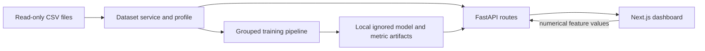

# VoxSense architecture

VoxSense runs as two local processes. The Next.js client reads supplied CSV data and persisted model artifacts through the FastAPI service; there is no remote service or separate database.

## Backend

- `app/core/config.py` derives repository paths from the source tree; no absolute data path is required.
- `app/services/data.py` reads the two named raw datasets and produces schema and overview payloads.
- `app/services/training.py` creates patient-disjoint train/test splits, performs grouped GridSearchCV only inside training patients, writes scikit-learn pipelines with fitted imputers/scalers, and saves measured metrics. Artifacts are loaded lazily at inference.
- `app/api/routes.py` validates numerical request values, serves data/profile/metrics, predictions, longitudinal summaries, and SHAP explanations. Missing artifacts return HTTP 503; unknown records return HTTP 404; missing feature values return HTTP 422.
- `ml/explore.py` generates a machine-readable quality profile and feature histograms without modifying raw files.

The classification grouping key is derived from `name` after removing its final recording suffix. Severity splits use `subject#`. Severity voice predictors exclude `subject#`, `test_time`, `age`, `sex`, and both targets. Median imputation is fitted within the training pipeline. Numeric outlier flags are descriptive and do not remove data.

## Frontend

`frontend/app/page.tsx` is a responsive interactive workspace structured around four primary sections:
1. **Overview**: Dataset cohort breakdown, key acoustic biomarker shifts, UPDRS timeline & pre-baseline recording audit, patient-disjoint model comparison, and interactive CTA.
2. **Analyze Voice Biomarkers**: Three-mode prediction and explainability workbench:
   - *Manual Analysis*: 22-feature validated acoustic measurement form grouped into five vocal subsystems with live range checking, class probabilities, and individual permutation SHAP explanations.
   - *Sample Patient Analysis*: Curated real dataset records distinguishing ground-truth labels from model predictions and held-out test subjects from training subjects.
   - *CSV Batch Analysis*: Local drag-and-drop CSV validation, preview, safe per-row error handling, and downloadable prediction CSV.
3. **Patient Insights**: Consolidated longitudinal UPDRS and vocal biomarker trajectory explorer with dual-participant comparison, recruitment-day vs. elapsed-day alignment, and a 42-participant summary table.
4. **About VoxSense**: Dataset provenance, complete 22-feature dictionary, leakage-free training methodology, interactive ROC/Confusion Matrix inspector, global SHAP beeswarm summary, known limitations, and medical disclaimer.

## Storage and execution

Raw CSVs remain in `data/raw/` and are ignored by Git. Trained models, metrics, and SHAP plot images are generated beneath ignored `backend/artifacts/`. No personal uploads, accounts, external database, or cloud processing are implemented. Run training from `backend/`, then start Uvicorn and the Next.js client independently as described in the root README.
