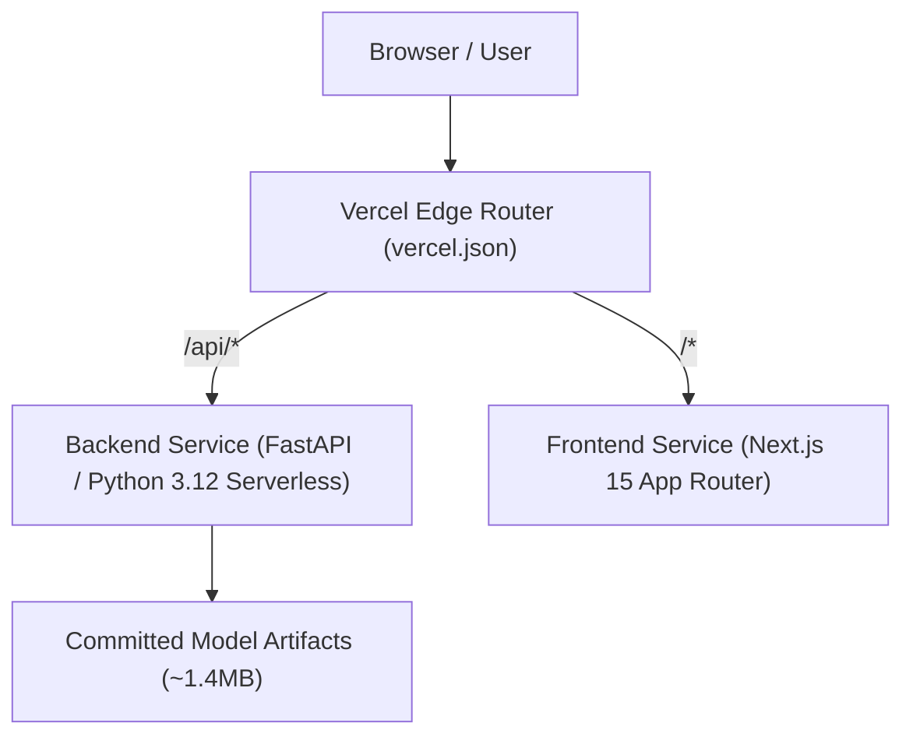

# Vercel Monorepo Deployment Guide for VoxSense

VoxSense is configured to deploy entirely on **Vercel** using **Vercel Services** within a single Vercel project. Both the Next.js frontend and the FastAPI Python ML backend are deployed together under the same origin domain.

---

## Architecture Overview



---

## 1. Root Configuration (`vercel.json`)

The root [`vercel.json`](file:///d:/VoxSense/vercel.json) defines the monorepo services and public routing rewrites:

```json
{
  "$schema": "https://openapi.vercel.sh/vercel.json",
  "services": {
    "frontend": {
      "root": "frontend/",
      "framework": "nextjs"
    },
    "backend": {
      "root": "backend/",
      "entrypoint": "app.main:app"
    }
  },
  "rewrites": [
    {
      "source": "/api",
      "destination": { "service": "backend" }
    },
    {
      "source": "/api/(.*)",
      "destination": { "service": "backend" }
    },
    {
      "source": "/(.*)",
      "destination": { "service": "frontend" }
    }
  ]
}
```

- Requests starting with `/api` route to the **backend** FastAPI service.
- All other requests route to the **frontend** Next.js service.
- Because frontend and backend are served from the same Vercel origin, cross-origin restrictions are completely eliminated.

---

## 2. Python Runtime & Dependencies

- **Python Version:** Set to `3.12` (supported by Vercel) via [`backend/.python-version`](file:///d:/VoxSense/backend/.python-version) and [`backend/pyproject.toml`](file:///d:/VoxSense/backend/pyproject.toml).
- **Entrypoint:** `app.main:app` (FastAPI instance in [`backend/app/main.py`](file:///d:/VoxSense/backend/app/main.py)).
- **Package Manifests:** Both `pyproject.toml` and `requirements.txt` are provided. Unused heavy dependencies (such as `plotly`) have been pruned to keep bundle sizes lean.

---

## 3. Machine Learning Artifacts & Data Isolation

Production inference does **not** require the raw dataset files (`data/raw/` remains ignored by Git).

All inference metadata and model weights are packaged into `backend/artifacts/` (total size **~1.4 MB**):
1. `classification.joblib` (18 KB) — Group-split trained SVM model with balanced weights.
2. `motor_UPDRS.joblib` (65 KB) — Trained Gradient Boosting regressor.
3. `total_UPDRS.joblib` (65 KB) — Trained Gradient Boosting regressor.
4. `metrics.json` (16 KB) — Holdout test confusion matrices and ROC curves.
5. `inference_metadata.json` (80 KB) — 22-feature distributions, cohort overview, and 8 curated sample patient records.
6. `progression_patients.json` (1.1 MB) — Complete 42-participant longitudinal trajectories for Patient Insights.
7. `shap_summary.png` (78 KB) — Global SHAP beeswarm image.

---

## 4. Vercel Function & Payload Limits

- **Payload Limit:** Vercel serverless functions enforce a **4.5 MB request/response body limit**.
- **Enforcement:** Both the client-side drag-and-drop handler in [`frontend/app/page.tsx`](file:///d:/VoxSense/frontend/app/page.tsx) and the FastAPI endpoint `POST /api/predict/batch` in [`backend/app/api/routes.py`](file:///d:/VoxSense/backend/app/api/routes.py) validate CSV file size against a **4 MB ceiling**, returning an HTTP `413 Payload Too Large` error with descriptive guidance if exceeded.

---

## 5. Step-by-Step Vercel Deployment Instructions

1. Push your repository to GitHub.
2. Go to **[vercel.com/new](https://vercel.com/new)** and import your repository (`RagulRishwanth/VoxSense-`).
3. Leave the **Root Directory** as the repository root (`./`), so Vercel detects `vercel.json`.
4. Click **Deploy**. Vercel will build both services automatically.
5. Once deployment completes, your app is live on your `*.vercel.app` domain.
